# ShootDesk screenshots

Taken by the cloud build on GitHub's Mac, on a regular iPhone simulator with no Aryeo key, so every tab shows its empty state.
On a regular iPhone, iOS puts the 5th and 6th tabs (Ask, Settings) under More, hence the back arrow on those two.
Build 9, commit ad66080, 2026-10-19 20:37 UTC. Replaced on every push to main.

## light-today

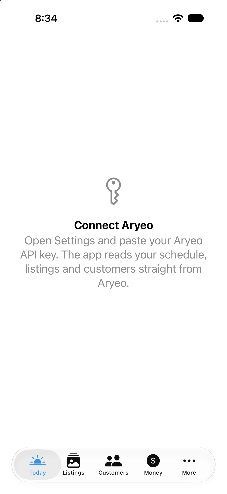

## light-listings

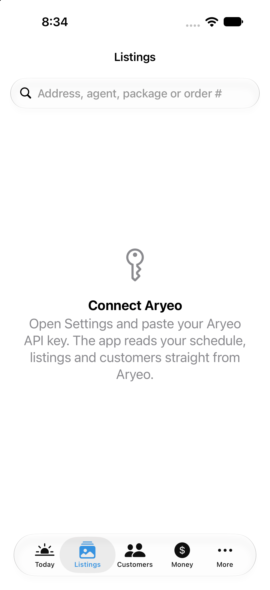

## light-customers

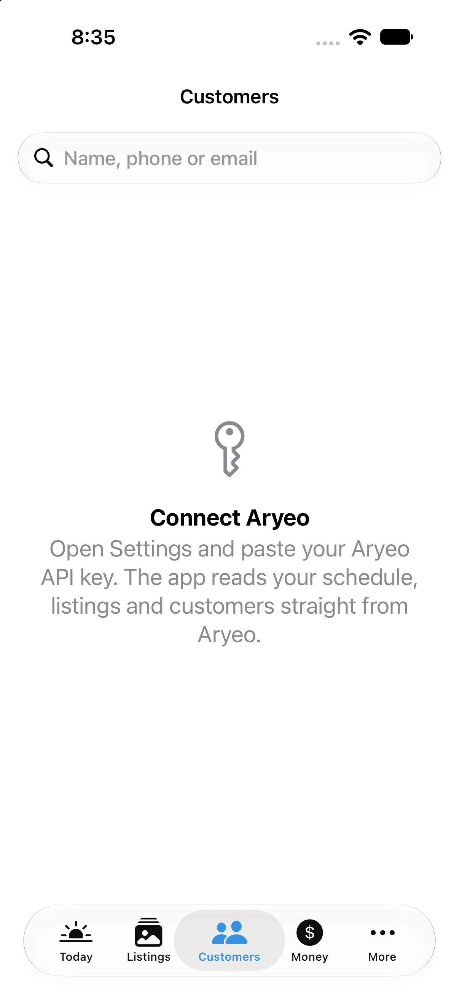

## light-money

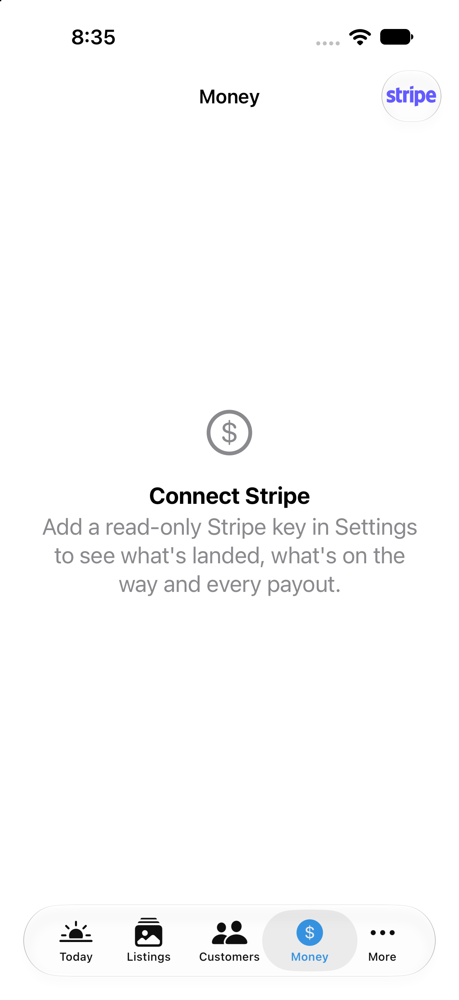

## light-ask

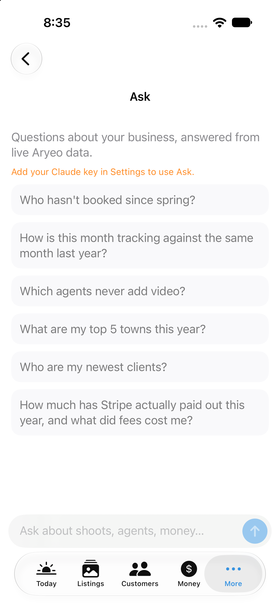

## light-settings

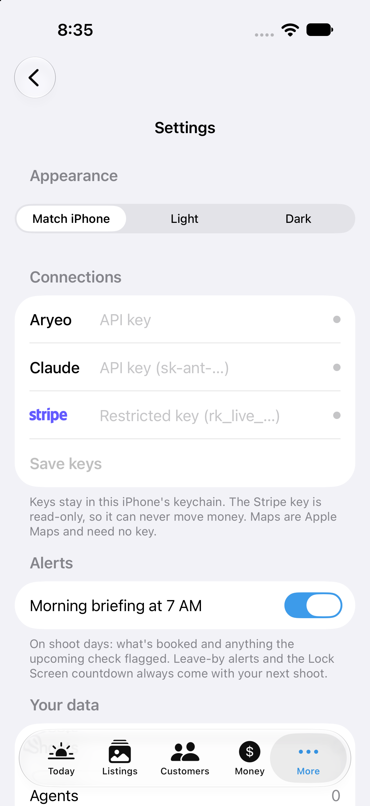

## dark-today

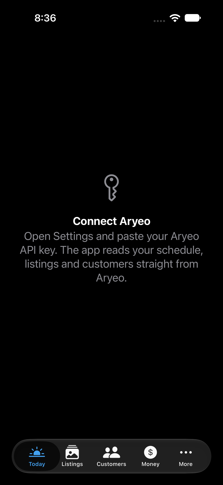

## dark-listings

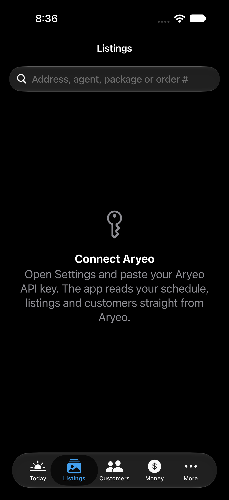

## dark-customers

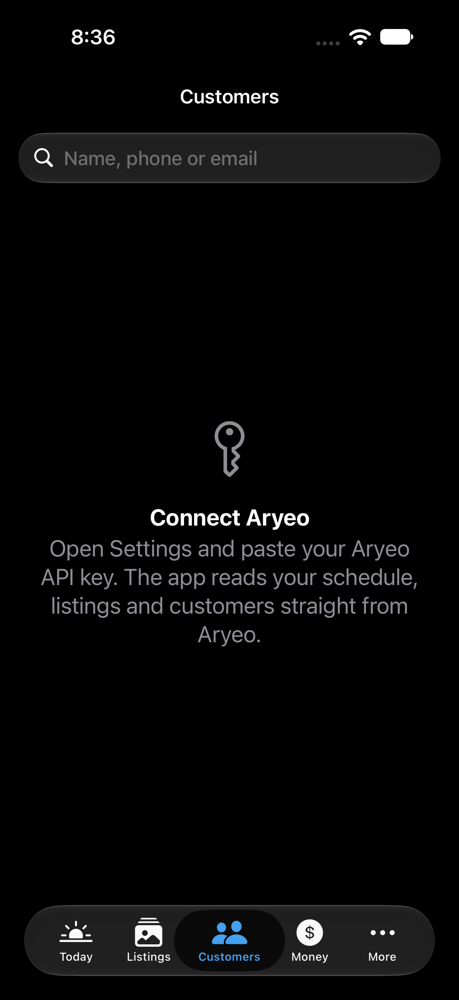

## dark-money

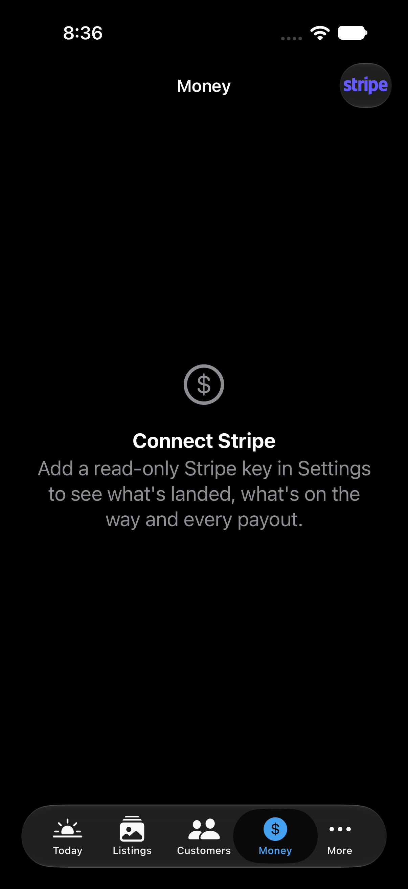

## dark-ask

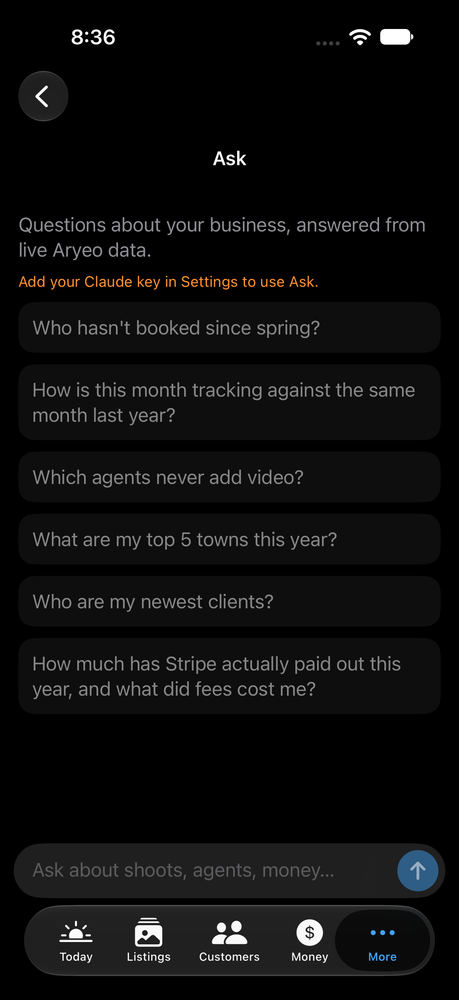

## dark-settings

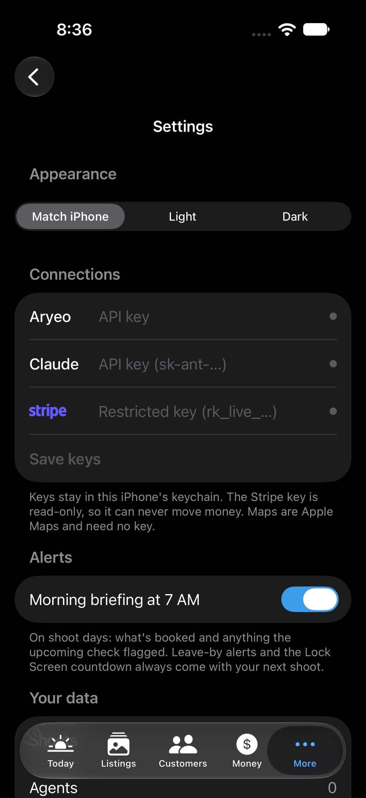

